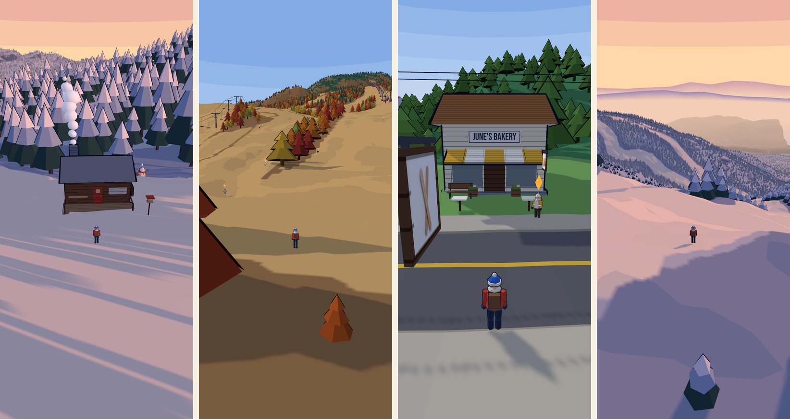
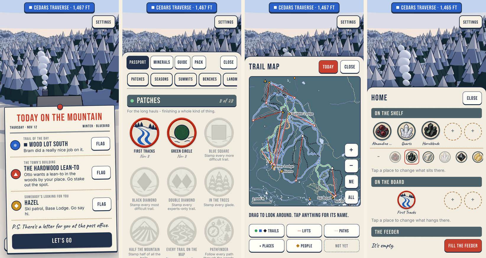

# gore-mtn

A cozy 3D collectathon on the real Gore Mountain and in North Creek, NY, drawn like a park
print. Built for an iPhone held upright and played with one thumb, as a web app on the Home
Screen.



Open it and the day's flyer is pinned up: what the sky is doing over Gore right now, and three
things worth going out for. Plant your flag on one and go. Ride a lift, ski a run you know by
name, pick up the garnets lying on the snow, come gently on a fox at the edge of the woods,
stamp your passport. Bring a stone home to the shelf by your cabin door and fill the feeder.
Tomorrow somebody is at it, and the town has built the thing you staked out.

- The whole mountain and the town at close to life size, from USGS elevation and
  OpenStreetMap: over ninety named trails, all fourteen lifts, four summits.
- Four seasons that follow the calendar, under the real hour and the real weather. Skis on
  snow, a mountain bike when it has gone, and a Snow Train to the other seasons.
- A Book to fill: a passport of trails, lifts, summits and places; twenty-five minerals; a
  field guide of forty-two animals, birds and plants; things to wear, letters, bakes and
  books. And a museum in town with empty cases, for showing what was found.
- A town to walk through, with twenty-six to meet (eighteen people, five boards, a dog, a
  cat who is mayor and a snowman) and thirty-nine errands that are never timed.
- A cabin of your own, a trail map to steer by, and five things the town builds because you
  went and staked out the spot.
- No timers, no fail states, nothing to buy. It works with no signal.



## Documents

- [Game plan](docs/game-plan.md): the game as it stands, and what is still open
- [Playtest guide](docs/playtest.md): what to try on the phone, and what to report
- [CLAUDE.md](CLAUDE.md): how the project is built and checked
- [History](docs/history.md): the plan it started from and a diary of each milestone
- [Credits](CREDITS.md): data sources, licences, and what made the pictures and models

## Run it

```
npm install
npm run dev          # local dev server
npm test             # unit tests
npm run build        # type-check and build to dist/
```

Hold the phone upright. The lower third of the screen is a movement stick; drag the picture
above it to look around, and pinch it to bring the camera nearer or further. `Skis` (or
`Bike`, once the snow has gone) glides: left and right steer, up tucks or pedals, down brakes.
At the orange gate at the foot of a lift, tap `Ride`. Walk up to someone with a gold mark to
talk. `Map` opens the trail map and `Book` shows everything collected. On a desktop: WASD,
Shift to go fast, drag to look, the wheel for the camera.

## Tools

The checks in `tools/` (screenshots, the touch test, the WebGPU smoke test, the benchmark)
drive the built game in headless Chromium and need [Playwright](https://playwright.dev) with
its Chromium available to Node (`npm install --no-save playwright && npx playwright install
chromium`; it is not a dependency of the game, and the deploy runs only the unit tests and the
build). Node 22 or later. Regenerating the world or the made models needs Python with
the packages in `tools/requirements.txt`. Making pictures and models calls outside services
whose keys are secrets of the build environment; none is in the repository.
